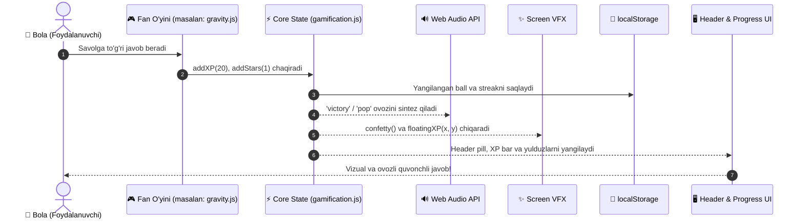

# 🏗️ EduKids — Tizim Arxitekturasi va Loyiha Strukturasi (ARCHITECTURE.md)

Ushbu hujjat **EduKids (Yoshlar Akademiyasi)** ta’lim platformasining texnik arxitekturasi, ma’lumotlar oqimi, modullari va papkalar tuzilishini belgilab beradi. Loyihani professional kengaytirish, texnik xizmat ko‘rsatish va yangi modullar qo‘shishda ushbu arxitekturaga qat’iy amal qilinadi.

---

## 📑 Mundarija

1. [Tizimning Umumiy Konsepsiyasi](#1-tizimning-umumiy-konsepsiyasi)
2. [Asosiy Arxitektura Printsiplari](#2-asosiy-arxitektura-printsiplari)
3. [Tavsiya Etiladigan Papkalar Strukturasi](#3-tavsiya-etiladigan-papkalar-strukturasi)
4. [Tizim Qatlamlari (System Layers)](#4-tizim-qatlamlari-system-layers)
5. [Ma’lumotlar Oqimi (Data Flow)](#5-malumotlar-oqimi-data-flow)
6. [Holat Boshqaruvi va Doimiylik (State & Persistence)](#6-holat-boshqaruvi-va-doimiylik-state--persistence)
7. [Oflayn Audio va VFX Tizimi](#7-oflayn-audio-va-vfx-tizimi)
8. [Lokalizatsiya va Kontent Boshqaruvi (i18n)](#8-lokalizatsiya-va-kontent-boshqaruvi-i18n)
9. [Xavfsizlik va Brauzerlararo Moslik](#9-xavfsizlik-va-brauzerlararo-moslik)
10. [Rivojlanish Bosqichlari (Roadmap & PWA)](#10-rivojlanish-bosqichlari-roadmap--pwa)

---

## 1. Tizimning Umumiy Konsepsiyasi

* **Loyiha Nomi:** EduKids (Yoshlar Akademiyasi)
* **Maqsadi:** 3–12 yoshdagi bolalarga Ingliz tili, Matematika, Fizika va boshqa fanlarni interaktiv, qiziqarli o‘yinlar va vizual laboratoriyalar orqali o‘rgatish.
* **Texnologik Stack:**
  * **Markup & Structure:** Sof HTML5 (Semantik va qulay).
  * **Styling:** Sof Vanilla CSS3 (CSS Variables, Flexbox, Grid, Glassmorphism, 3D transformatsiyalar).
  * **Logic & Engine:** Sof JavaScript (ES6+ Modules, Web Audio API, Web Speech API).
  * **Tashqi Bog‘liqliklar (Dependencies):** Nol (Zero external build dependencies / bundler-free). Sayt to‘g‘ridan-to‘g‘ri brauzerda ochiladi va 100% oflayn ishlay oladi.

---

## 2. Asosiy Arxitektura Printsiplari

1. **Zero-Build & Offline-First (Nol-Build va Oflayn Birinchi):**
   Loyiha ishlashi uchun Node.js yoki maxsus build-server shart emas. Har qanday qurilmada oddiy brauzer orqali ochilishi, internet uzilgan paytda ham barcha o‘yinlar, audio effektlar va taraqqiyot saqlanib qolishi shart.
2. **Data-Driven Architecture (Ma’lumotlarga Asoslangan Dizayn):**
   Savollar, dars matnlari, misollar va tajriba parametrlari JavaScript funksiyalari ichida qattiq kodlanmaydi (hardcode qilinmaydi), balki `data/*.json` yoki alohida ma’lumotlar obyektlarida saqlanadi.
3. **Single Source of Truth (Yagona Haqiqat Manbai):**
   XP, darajalar, streak (kunlik olov), to‘plangan yulduzlar va sozlamalar (ovoz, mavzu, til) barcha fanlar uchun yagona holat boshqaruvchisi orqali yuritiladi.
4. **Modulli Izolyatsiya (Modular Isolation):**
   Har bir fan (`math/`, `english/`, `physics/`) mustaqil mini-dastur sifatida yashaydi. Biror fanda xatolik yuz bersa, bu boshqa fanlarning ishlashiga ta’sir ko‘rsatmaydi.
5. **Ergonomika va Bolalar Psixologiyasi:**
   Barcha interaktiv elementlar 3D taktil shaklga ega, tugmalar katta (`>= 44px`), javob reaktsiyalari elastik animatsiya (`cubic-bezier`), ovoz va konfetti bilan taqdirlanadi.

---

## 3. Tavsiya Etiladigan Papkalar Strukturasi

Loyihaning uzoq muddatli va tartibli arxitekturasi quyidagicha shakllantiriladi:

```
yosh-bolachalar-uchun/
│
├── index.html                     # Bosh portal (Hub / Fanlar vitrinasi)
├── DESIGN.md                      # UI/UX dizayn tizimi va rang tokenlari
├── AGENTS.md                      # AI agentlar uchun qat'iy standartlar
├── ARCHITECTURE.md                # Tizim arxitekturasi va texnik yo'riqnoma
├── package.json                   # Loyiha metama'lumotlari (kerak bo'lsa)
│
├── core/                          # Tizimning poydevori (Core Engine)
│   ├── state.js                   # Reaktiv holat (XP, Level, Stars, Streak)
│   ├── storage.js                 # localStorage bilan xavfsiz ishlash va zaxira
│   ├── audio.js                   # Web Audio API (Oflayn sintezlangan tovushlar)
│   ├── speech.js                  # Ovozli o'qish (Web Speech API / uzbek-speech)
│   └── vfx.js                     # Ekran effektlari (Screen shake, confetti, XP)
│
├── locales/                       # Matnlar va tarjimalar (i18n)
│   ├── uz.json                    # O'zbekcha to'liq matnlar bazasi
│   └── ru.json                    # Ruscha to'liq matnlar bazasi
│
├── shared/                        # Umumiy UI komponentlar va tizimlar
│   ├── css/
│   │   ├── tokens.css             # Ranglar, shriftlar, soyalar, radius tokenlari
│   │   ├── shared.css             # Asosiy umumiy stillar
│   │   ├── components.css         # 3D tugmalar, kartalar, pill tasmachasi
│   │   ├── chatbot.css            # AI maskot modal stillari
│   │   ├── level-map.css          # Dunyo xaritasi stillari
│   │   └── subscription.css       # Obuna va Yulduzlar do'koni stillari
│   └── js/
│       ├── header.js              # Yagona boshqaruv sarlavhasi (Header)
│       ├── gamification.js        # XP hisoblash, unvonlar va yutuqlar
│       ├── level-map.js           # Xarita logikasi va progress yo'li
│       ├── mascot-companion.js    # Ekrandagi jonli maskot va fikr pufaklari
│       ├── subscription.js        # Yulduzlar do'koni va ota-onalar PIN darvozasi
│       └── chatbot.js             # Do'stona AI suhbatdoshi
│
├── math/                          # 🚀 Matematika Moduli
│   ├── index.html
│   ├── css/
│   │   └── style.css              # Matematika vizual mavzusi (Blue / Orange / Green)
│   ├── data/
│   │   └── tasks.json             # Savollar, misollar, shakllar bazasi
│   └── js/
│       ├── counter.js             # Sanash va obyektlar
│       ├── arithmetic.js          # Qo'shish / Ayirish doskasi
│       ├── multiplication.js      # Ko'paytirish matritsasi
│       └── main.js                # Matematika fanining bosh koordinatori
│
├── english/                       # 🦁 Ingliz Tili Moduli
│   ├── index.html
│   ├── css/
│   │   └── style.css              # Ingliz tili mavzusi (Coral / Mint / Yellow)
│   ├── data/
│   │   └── vocabulary.json        # Lug'at, fonika, toifalar bazasi
│   └── js/
│       ├── phonics.js             # Harflar va talaffuz
│       ├── word-builder.js        # So'z yig'ish o'yini
│       ├── balloon-game.js        # Sharlar uchirish o'yini
│       └── main.js
│
├── physics/                       # ⚛️ Fizika Moduli
│   ├── index.html
│   ├── css/
│   │   └── style.css              # Fizika mavzusi (Violet / Cyan / Amber)
│   ├── data/
│   │   └── simulations.json       # Gravitatsiya, linzalar, tok kuchi parametrlari
│   └── js/
│       ├── gravity.js             # Erkin tushish va to'siqlar
│       ├── circuits.js            # Elektr zanjiri va kalit
│       ├── optics.js              # Ranglar va prizma simulyatori
│       └── main.js
│
└── assets/                        # Statik Resurslar
    ├── icons/                     # SVG belgilar va ramzlar
    └── img/                       # Maskotlar, fon naqshlari va illyustratsiyalar
```

---

## 4. Tizim Qatlamlari (System Layers)

```
┌─────────────────────────────────────────────────────────────┐
│ 1. TAQDIMOT QATLAMI (UI / Presentation Layer)              │
│    - Unified Header, 3D Buttons, Cards, Modals, Maps       │
│    - Fredoka & Quicksand Shriftlari, CSS Tokenlar          │
└──────────────────────────────┬──────────────────────────────┘
                               │
┌──────────────────────────────▼──────────────────────────────┐
│ 2. O‘YIN VA FANLAR LOGIKASI (Subject Game Engines)         │
│    - Math Engine, English Phonics, Physics Simulations     │
│    - Interaktiv boshqotirmalar va darsliklar                │
└──────────────────────────────┬──────────────────────────────┘
                               │
┌──────────────────────────────▼──────────────────────────────┐
│ 3. ASOSIY XIZMATLAR (Core Services Layer)                   │
│    - EduState: XP, Level, Stars, Streak hisoblagich         │
│    - Sound & VFX Engine: Web Audio sintezi, Konfetti       │
│    - Speech Engine: O‘zbekcha/Ruscha ovozli o‘qish         │
│    - i18n Engine: Tilni dinamik almashtirish               │
└──────────────────────────────┬──────────────────────────────┘
                               │
┌──────────────────────────────▼──────────────────────────────┐
│ 4. MA’LUMOT VA SAQLASH (Persistence & Data Layer)          │
│    - LocalStorage (Avtomatik saqlash va himoyalash)         │
│    - Data JSON fayllar (Savollar, so‘zlar, tajribalar)     │
└─────────────────────────────────────────────────────────────┘
```

---

## 5. Ma’lumotlar Oqimi (Data Flow)

Har bir bolaning harakati (masalan: to‘g‘ri javob berishi) quyidagi qat’iy zanjir bo‘yicha harakatlanadi:



---

## 6. Holat Boshqaruvi va Doimiylik (State & Persistence)

### Yagona State Modeli:
Barcha ma’lumotlar `localStorage` da `kiddos_academy_v1` kaliti ostida yagona JSON strukturada saqlanadi:

```json
{
  "profile": {
    "name": "Yosh Daho",
    "avatar": "🦁",
    "createdAt": 1729320000000
  },
  "progress": {
    "xp": 380,
    "level": 4,
    "levelTitle": "Izlanuvchi Daho",
    "stars": 45,
    "streak": 5,
    "lastActiveDate": "2026-10-19"
  },
  "subjects": {
    "math": { "completedLevels": [1, 2, 3], "highScore": 120 },
    "english": { "completedLevels": [1, 2], "learnedWords": 35 },
    "physics": { "completedLevels": [1], "experimentsDone": 4 }
  },
  "settings": {
    "soundEnabled": true,
    "theme": "light",
    "language": "uz"
  },
  "subscription": {
    "plan": "free",
    "unlockedBadges": ["first_win", "streak_3"]
  }
}
```

---

## 7. Oflayn Audio va VFX Tizimi

1. **Web Audio API Sintezi (100% Oflayn):**
   * Loyihada og‘ir `.mp3` yoki `.wav` fayllar yuklanmaydi.
   * Ovozlar brauzerning ichki ossillyatorlari (`Sine`, `Triangle`, `Sawtooth`) orqali matematik formulalar yordamida generatsiya qilinadi:
     * `playPop()` — Qisqa pufak yorilishi (500Hz -> 100Hz).
     * `playSuccess()` — Quvnoq uch ohangli akkord (C5, E5, G5).
     * `playLevelUp()` — Fanfara arpedjiosi.
     * `playError()` — Yumshoq past tonli signal.
2. **Ekran Effektlari (Screen VFX):**
   * `ScreenVFX.confetti()` — Canvas orqali uchuvchi 70 ta rangli zarralar.
   * `ScreenVFX.screenShake()` — Noto‘g‘ri harakatda ekranning 300ms lik tebranishi.
   * `ScreenVFX.floatingXP(x, y, text)` — Bosilgan joydan havoga ko‘tariluvchi ball belgisi.

---

## 8. Lokalizatsiya va Kontent Boshqaruvi (i18n)

Barcha matnlar HTML yoki JS ichida tarqoq holda emas, yagona kalitlar orqali boshqariladi:

```json
// locales/uz.json namunasi
{
  "hub": {
    "welcome": "Xush kelibsiz, Yosh Daho!",
    "subjects_title": "Qaysi olamga sayohat qilamiz?",
    "tagline": "O‘yinlar orqali kelajakni kashf et!"
  },
  "math": {
    "title": "Matematika Olami",
    "desc": "Raqamlar, hisob-kitob va fazoviy shakllar!"
  }
}
```

Til o‘zgarganda butun sahifadagi `[data-i18n="key"]` atributiga ega elementlar bir lahzada yangilanadi.

---

## 9. Xavfsizlik va Brauzerlararo Moslik

1. **Safari iOS Qat’iy Qoidalari:**
   * Barcha tugma va nav-itemlarda matn ko‘k bo‘lib qolmasligi uchun:
     ```css
     -webkit-user-select: none;
     user-select: none;
     ```
   * Barcha shisha effekti panellarida:
     ```css
     -webkit-backdrop-filter: blur(14px);
     backdrop-filter: blur(14px);
     ```
   * Bosilganda ko‘k dog‘ paydo bo‘lmasligi uchun:
     ```css
     -webkit-tap-highlight-color: transparent;
     ```
2. **Bolalar Xavfsizligi (Child Safety):**
   * AI Chatbot promptlarida tashqi noma’qul mavzular qat’iy filtrlanadi.
   * Ota-onalar sozlamalari va obuna bo‘limi oddiy matematik masalali PIN-kod bilan himoyalangan (`Parent Gate`).

---

## 10. Rivojlanish Bosqichlari (Roadmap & PWA)

| Bosqich | Rejalashtirilgan Imkoniyatlar | Texnik Maqsad |
| :--- | :--- | :--- |
| **I Bosqich (Hozirgi)** | Hub va 3 ta asosiy fan (Math, English, Physics) integratsiyasi, dizayn tizimi, 100% oflayn audio. | Ishonchli va xatosiz poydevor. |
| **II Bosqich** | Ma’lumotlarni `data/*.json` ga to‘liq ajratish, i18n tizimini to‘liq joriy qilish. | Yangi o‘yinlar va savollarni kodsiz qo‘shish. |
| **III Bosqich (PWA)** | `manifest.json` va `service-worker.js` qo‘shish. | Saytni planshet va telefonga haqiqiy ilova kabi o‘rnatish. |
| **IV Bosqich** | Yangi fanlar: `chemistry/` (Kimyo), `biology/` (Biologiya), `astronomy/` (Koinot). | 100+ o‘yinli to‘liq Yoshlar Akademiyasi portali. |

---

*Hujjat versiyasi: 1.0.0*  
*Muallif: EduKids Tizim Arxitekturasi Jamoasi*  
*Aloqador fayllar: [DESIGN.md](file:///c:/Users/Salohiddin/OneDrive/Desktop/yosh%20bolachalar%20uchun/DESIGN.md) | [AGENTS.md](file:///c:/Users/Salohiddin/OneDrive/Desktop/yosh%20bolachalar%20uchun/AGENTS.md)*
