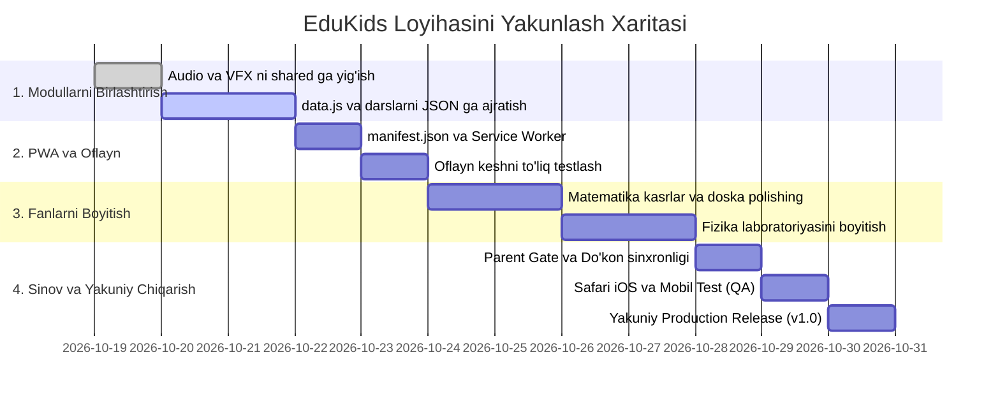

# 📋 EduKids — Mahsulot Talablari Hujjati (PRD.md)
### Product Requirements Document — Loyihani 100% Yakunlash Rejasi

---

## 📌 Hujjat Metama’lumotlari
* **Loyiha Nomi:** EduKids (Yoshlar Akademiyasi)
* **Mahsulot Turi:** 3–12 yoshli bolalar uchun gamifikatsiyalashgan, interaktiv va 100% oflayn ta’lim portali.
* **Hujjat Versiyasi:** 1.0.0 (Yakuniy ishlab chiqish va ishlab chiqarishga chiqarish rejasi)
* **Status:** Faol Ijroda (In Progress)
* **Aloqador Hujjatlar:** [DESIGN.md](file:///c:/Users/Salohiddin/OneDrive/Desktop/yosh%20bolachalar%20uchun/DESIGN.md) | [ARCHITECTURE.md](file:///c:/Users/Salohiddin/OneDrive/Desktop/yosh%20bolachalar%20uchun/ARCHITECTURE.md) | [AGENTS.md](file:///c:/Users/Salohiddin/OneDrive/Desktop/yosh%20bolachalar%20uchun/AGENTS.md) | [CYBERSECURITY.md](file:///c:/Users/Salohiddin/OneDrive/Desktop/yosh%20bolachalar%20uchun/CYBERSECURITY.md)

---

## 📑 Mundarija

1. [Mavjud Holat Tahlili (Current State Analysis)](#1-mavjud-holat-tahlili-current-state-analysis)
2. [Mahsulot Viziyasi va Asosiy Maqsadlar](#2-mahsulot-viziyasi-va-asosiy-maqsadlar)
3. [Foydalanuvchilar Portreti (User Personas)](#3-foydalanuvchilar-portreti-user-personas)
4. [Batafsil Funksional Talablar (Functional Requirements)](#4-batafsil-funksional-talablar-functional-requirements)
   - [4.1. Bosh Hub Portali (`index.html`)](#41-bosh-hub-portali-indexhtml)
   - [4.2. Matematika Moduli (`math/`)](#42-matematika-moduli-math)
   - [4.3. Ingliz Tili Moduli (`english/`)](#43-ingliz-tili-moduli-english)
   - [4.4. Fizika Moduli (`physics/`)](#44-fizika-moduli-physics)
   - [4.5. Umumiy Gamifikatsiya va Iqtisodiyot Tizimi](#45-umumiy-gamifikatsiya-va-iqtisodiyot-tizimi)
   - [4.6. AI Yordamchi Maskot (Chatbot & Speech)](#46-ai-yordamchi-maskot-chatbot--speech)
   - [4.7. Ota-onalar Kabineti va Obuna (Parent Gate & Pro)](#47-ota-onalar-kabineti-va-obuna-parent-gate--pro)
5. [Nofunksional Talablar (NFR)](#5-nofunksional-talablar-nfr)
6. [Loyihani 100% Tugatish Bosqichlari (Milestones & Roadmap)](#6-loyihani-100-tugatish-bosqichlari-milestones--roadmap)
7. [Qabul Qilish Mezonlari (Definition of Done)](#7-qabul-qilish-mezonlari-definition-of-done)

---

## 1. Mavjud Holat Tahlili (Current State Analysis)

Loyihaning amaldagi kodi chuqur tekshirilganda quyidagi holat aniqlandi:

### ✅ Tayyor va Yuqori Darajada Bajarilgan Qismlar:
1. **Dizayn va Vizual Standart:** Bosh sahifa va barcha fanlarda zamonaviy bolalar dizayni (Fredoka/Quicksand shriftlari, 3D taktil tugmalar, elastik animatsiyalar, Light/Dark rejim).
2. **Yagona Header va Navigatsiya:** Fanlararo tezkor o‘tish tasmachasi (`.header-subject-nav`), darajalar, yulduzlar va streak olovi to‘liq integratsiyalangan.
3. **Boy Kontent Bazasi:**
   - **Ingliz tili:** 327KB li boy lug‘at bazasi (`data.js`), fonika, harflar, so‘z yig‘ish va sharlar o‘yini.
   - **Matematika:** Sanash, qo‘shish/ayirish, ko‘paytirish matritsasi, interaktiv kasrlar laboratoriyasi (`fraction-sandbox.js`), chizma doska (`whiteboard.js`).
   - **Fizika:** Gravitatsiya, elektr zanjirlari, optika/prizma simulyatori (`physics-sandbox.js`), tajribalar va testlar.
4. **Mustaqil Oflayn Tizimlar:** Web Audio API orqali sintezlangan ovozlar, Web Speech API (o‘zbekcha ovoz), mahalliy xotira (`localStorage`).

### ⚠️ Tugatilishi va To‘g‘rilanishi Kerak Bo‘lgan Kamchiliklar:
1. **Kod Dublikatlari:** `audio.js` va `confetti.js` har uchala fanda (`math`, `english`, `physics`) alohida qayta yozilgan. Ular `shared/` ga birlashtirilishi kerak.
2. **PWA (Progressive Web App) Yo‘qligi:** `manifest.json` va `service-worker.js` mavjud emas. Internet o‘chib qolsa, sahifani yangilaganda sayt ochilmay qoladi.
3. **Yulduzlar Do‘konining Bog‘liqligi:** Yulduzlar evaziga sotib olingan narsalar (yangi avatarlar, nishonlar) fanlar ichidagi maskotga to‘liq ta’sir qilmaydi.
4. **Lokalizatsiya Sinxronligi:** Matnlarning bir qismi HTML/JS ichida aralashib yotibdi, yagona `locales/uz.json` va `locales/ru.json` formatiga keltirish talab etiladi.

---

## 2. Mahsulot Viziyasi va Asosiy Maqsadlar

* **Viziyasi:** O‘zbekistondagi har bir bola internet bo‘lmagan qishloq yoki chekka joyda ham kompyuter yoki planshetda jahon andozasidagi interaktiv fanlarni bepul va quvnoq o‘rgana oladigan yagona milliy platforma bo‘lish.
* **Metrikalar (KPI):**
  * O‘rtacha dars sessiyasi: **12–18 daqiqa**.
  * Darsni muvaffaqiyatli yakunlash ulushi: **> 85%**.
  * Sahifa yuklanish tezligi: **< 1.0 soniya**.
  * Tashqi kutubxonalarga bog‘liqlik: **0% (Sof HTML/CSS/JS)**.

---

## 3. Foydalanuvchilar Portreti (User Personas)

| Persona | Yoshi | Xatti-harakati va Ehtiyoji | Bizning Yechimimiz |
| :--- | :---: | :--- | :--- |
| **Kichkintoy (Ali)** | 3–6 yosh | O‘qishni bilmaydi, faqat rasm, rang va tovushlarga qaraydi. | Katta 3D rasmlar, ovozli aytib berish (TTS), sharlar yorish, sanash. |
| **Maktab o‘quvchisi (Madina)** | 7–11 yosh | O‘yin qoidalarini tushunadi, raqobat va yutuqlarni yaxshi ko‘radi. | Ko‘paytirish jadvali, fizika laboratoriyasi, XP, kunlik streak, level-map. |
| **Ota-ona (Dilshod aka)** | 30–45 yosh | Bolaning telefon titishidan xavotirda, xavfsiz ta’limiy dastur istaydi. | Zero-PII (reklamasiz, chatlarsiz), Ota-onalar PIN darvozasi, haftalik natija. |

---

## 4. Batafsil Funksional Talablar (Functional Requirements)

### 4.1. Bosh Hub Portali (`index.html`)
* **FR-1.1:** 3 ta fanning (Ingliz tili, Matematika, Fizika) 3D interaktiv hero-kartochkalari.
* **FR-1.2:** Umumiy bolaning darajasi (`Level X`), to‘plangan jami yulduzlar va faol streak kunlari ko‘rinib turishi.
* **FR-1.3:** Tilni bir marta bosish bilan (UZ $\leftrightarrow$ RU) butun sahifadagi matnlarni bir zumda o‘zgartirish.
* **FR-1.4:** Bosh sahifadan to‘g‘ridan-to‘g‘ri Yulduzlar do‘koni va Level Map (Dunyo xaritasi) modalini ochish.

### 4.2. Matematika Moduli (`math/`)
* **FR-2.1: Sanash Laboratoriyasi:** Jonli mevalar, yulduzchalar va o‘yinchoqlarni sanash va to‘g‘ri raqamni topish.
* **FR-2.2: Arifmetika Trenajyori:** Qo‘shish va ayirish bo‘yicha 3 ta qiyinlik darajasi (1-10, 1-20, 1-100).
* **FR-2.3: Ko‘paytirish Matritsasi:** 1 dan 10 gacha bo‘lgan sonlarning vizual rangli ko‘paytirish jadvali va tezlikka oid mini-viktorina.
* **FR-2.4: Kasrlar Sandboxi (`fraction-sandbox.js`):** Pitsa va pirog bo‘laklari orqali kasrlarni (1/2, 1/4, 3/4) tushuntirish.
* **FR-2.5: Erkin Chizma Doskasi (`whiteboard.js`):** Bolaning hisob-kitobni o‘zi chizib hisoblashi uchun rangli qalamli doska.

### 4.3. Ingliz Tili Moduli (`english/`)
* **FR-3.1: Interaktiv Alifbo va Fonika:** A dan Z gacha bo‘lgan barcha harflar, har bir harfga mos 3 tadan so‘z va ularning toza talaffuzi.
* **FR-3.2: So‘z Yig‘uvchi (Word Builder):** Harflarni sudrab (Drag-and-drop) yoki bosib so‘z yasash o‘yini.
* **FR-3.3: Sharlar Uchirish O‘yini (Balloon Pop):** Ovoz eshittiriladi (*"Pop the Apple!"*), bola to‘g‘ri sharni topib yorishi kerak.
* **FR-3.4: Tematik Toifalar:** Hayvonlar, Ranglar, Mevalar, Oila, Maktab buyumlari bo‘yicha 100+ vizual so‘z kartalari.

### 4.4. Fizika Moduli (`physics/`)
* **FR-4.1: Gravitatsiya Simulyatsiyasi:** Har xil sayyoralarda (Yer, Oy, Yupiter) buyumlarning tushish tezligini sinash.
* **FR-4.2: Elektr Zanjiri Laboratoriyasi:** Batareya, sim, kalit (switch) va lampochkani ulab chiroqni yoqish tajribasi.
* **FR-4.3: Optika va Prizma:** Oq yorug‘lik nurini prizma orqali o‘tkazib kamalak ranglariga ajratish.
* **FR-4.4: Suzish yoki Cho‘kish (Arximed qonuni):** Yog‘och, tosh, temir koptokni suvga tashlab ko‘rish.

### 4.5. Umumiy Gamifikatsiya va Iqtisodiyot Tizimi
* **FR-5.1:** Har bir to‘g‘ri javob uchun: `+10 XP` va har bir dars yakunida: `+1 Yulduzcha ⭐`.
* **FR-5.2:** 100 XP to‘planganda daraja oshishi (`Level Up!`), ekranga konfetti va fanfara musiqasi chiqishi.
* **FR-5.3: Yulduzlar Do‘koni (Star Shop):** To‘plangan yulduzlarni sarflab yangi maxsus avatarlar (Astronavt 👨‍🚀, Daho Dinozavr 🦖, Sehrgar 🧙‍♂️) va maxsus tabrik unvonlarini ochish.
* **FR-5.4: Kunlik Streak (Olov):** Bola har kuni kirganida olov darajasi oshib boradi (1 kun, 2 kun, 3 kun...).

### 4.6. AI Yordamchi Maskot (Chatbot & Speech)
* **FR-6.1:** Ekranning pastki burchagidagi suzuvchi interaktiv avatar.
* **FR-6.2:** Bolaning harakatiga qarab quvonish, o‘ylanish va olqishlash emotsiyalari.
* **FR-6.3:** Internet bor paytda Gemini API orqali bolalar savollariga javob berish; internet yo‘qligida 200+ ta tayyor oflayn bolalar savol-javoblar bazasidan foydalanish.
* **FR-6.4:** Barcha ko‘rsatmalar va matnlarni o‘zbek va rus tillarida nutq orqali aytib berish (`uzbek-speech.js`).

### 4.7. Ota-onalar Kabineti va Obuna (Parent Gate & Pro)
* **FR-7.1:** Bolalar tasodifan to‘lov qilmasligi uchun 2 xonali arifmetik misol bilan himoyalangan darvoza (`Parent Gate`).
* **FR-7.2:** Ota-onalar uchun bolaning haftalik dars sarflagan vaqti va yutuqlari hisoboti.
* **FR-7.3:** Pro tarifga ulanish (Click, Payme, Uzcard, Humo simulyatsiyasi va xavfsiz to‘lov yo‘li).

---

## 5. Nofunksional Talablar (NFR)

* **NFR-1 (Ishlash Tezligi):** Sahifaning to‘liq yuklanish vaqti 3G internetda ham **1.5 soniyadan oshmasligi**, animatsiyalar **60 kadr/soniya (FPS)** tezlikda silliq ishlashi shart.
* **NFR-2 (Oflayn Qobiliyat):** Service Worker o‘rnatilgach, internet uzilgan holatda portal 100% o‘z funksiyalarini saqlab qolishi lozim.
* **NFR-3 (Moslashuvchanlik):** 320px (kichik telefonlar), 768px (iPad/planshet) va 1920px (katta monitorlar) da mukammal responsive ko‘rinish.
* **NFR-4 (Xavfsizlik):** 100% Zero-PII, hech qanday shaxsiy ma’lumotlar serverga yuborilmaydi, faqat lokal `localStorage` ishlatiladi.
* **NFR-5 (Brauzerlararo Moslik):** Safari (iOS), Chrome, Firefox, Edge brauzerlarida to‘liq sinovdan o‘tgan bo‘lishi lozim.

---

## 6. Loyihani 100% Tugatish Bosqichlari (Milestones & Roadmap)

### Batafsil Ishlar Ro‘yxati:

#### 1-Bosqich: Arxitekturani Tozalash va Yagona Yadroga Keltirish
- [ ] Har bir fandagi (`math`, `english`, `physics`) dublikat `audio.js` va `confetti.js` fayllarini o‘chirib, barchasini `shared/screen-vfx.js` va `shared/gamification.js` ga ulash.
- [ ] Ingliz tili so‘zlari (`data.js`) va fizika tajribalarini alohida toza ma’lumotlar obyektlariga ajratish.

#### 2-Bosqich: PWA (Progressive Web App) Integratsiyasi
- [ ] Loyiha ildizida `manifest.json` yaratish (nomi, piktogrammalari, mavzu rangi `#2563EB`, display: `standalone`).
- [ ] `sw.js` (Service Worker) yaratish va barcha HTML, CSS, JS fayllarni keshga olish (Cache-First strategiyasi).
- [ ] Telefonda "Ilovani o‘rnatish" (Install App) taklifini chiqaruvchi boshqaruv tugmasi.

#### 3-Bosqich: Barcha Fanlar Interaktivligini 100% Ga Yetkazish
- [ ] **Matematika:** Barcha 10 ta darajani to‘liq savollar bilan to‘ldirish, doska (whiteboard) dagi chizmalarni tozalash va saqlash imkoniyatini sozlash.
- [ ] **Ingliz tili:** Barcha 26 ta harf fonikasini to‘liq ovozlar bilan sinovdan o‘tkazish, so‘z yasash o‘yiniga 50 ta yangi so‘z qo‘shish.
- [ ] **Fizika:** Prizma va tok zanjiri simulyatsiyalariga yangi qiziqarli elementlar (kalitlar, rezistorlar, har xil suyuqliklar) qo‘shish.

#### 4-Bosqich: Yulduzlar Do‘koni va Gamifikatsiyani Birlashtirish
- [ ] Do‘kondan sotib olingan avatar darhol barcha sahifalardagi Header profilida va Maskot companionida aks etishi.
- [ ] Kunlik streak (olov) tizimini real kalendar sanalari bilan solishtiruvchi mantiqni sinovdan o‘tkazish.

#### 5-Bosqich: Yakuniy QA va Ishlab Chiqarishga Chiqarish (Production Launch)
- [ ] Safari iOS (iPhone / iPad) da barcha tugmalar, ovozlar va shisha effektlarini to‘liq tekshirish.
- [ ] Android Chrome da sensor sezgirligi va tebranishlarni tekshirish.
- [ ] Barcha linter va konsol xatolarini (console.log / warning) tozalash.

---

## 7. Qabul Qilish Mezonlari (Definition of Done)

Loyiha quyidagi barcha shartlar bajarilgandagina **to‘liq yakunlangan (Done)** deb hisoblanadi:

1. **100% Oflayn Test:** Internet simi uzilganda yoki samolyot rejimida sayt butunlay xatosiz ochiladi, barcha 3 ta fan o‘yinlari ishlaydi, ovozlar yangraydi va yulduzlar saqlanadi.
2. **Nol Xatolik (Zero Console Errors):** Barcha sahifalarda konsolda birorta ham qizil xatolik yoki brauzer moslik ogohlantirishi bo‘lmasligi.
3. **Responsive Dizayn:** 320px dan 1920px gacha bo‘lgan barcha ekranlarda elementlar ustma-ust tushib ketmaydi, matnlar to‘g‘ri sig‘adi.
4. **Parent Gate Ishonchliligi:** Ota-onalar savoliga to‘g‘ri javob berilmaguncha hech qanday tashqi havola yoki obuna oynasi ochilmaydi.
5. **Hujjatlarning To‘liqligi:** [DESIGN.md](file:///c:/Users/Salohiddin/OneDrive/Desktop/yosh%20bolachalar%20uchun/DESIGN.md), [ARCHITECTURE.md](file:///c:/Users/Salohiddin/OneDrive/Desktop/yosh%20bolachalar%20uchun/ARCHITECTURE.md), [AGENTS.md](file:///c:/Users/Salohiddin/OneDrive/Desktop/yosh%20bolachalar%20uchun/AGENTS.md), [CYBERSECURITY.md](file:///c:/Users/Salohiddin/OneDrive/Desktop/yosh%20bolachalar%20uchun/CYBERSECURITY.md) va [PRD.md](file:///c:/Users/Salohiddin/OneDrive/Desktop/yosh%20bolachalar%20uchun/PRD.md) amaldagi kod bilan 100% mos kelishi.

---

*Hujjat versiyasi: 1.0.0*  
*Tasdiqlovchi: EduKids Mahsulot Boshqaruvi va Rivojlantirish Jamoasi*  
*Sana: 2026-yil*
